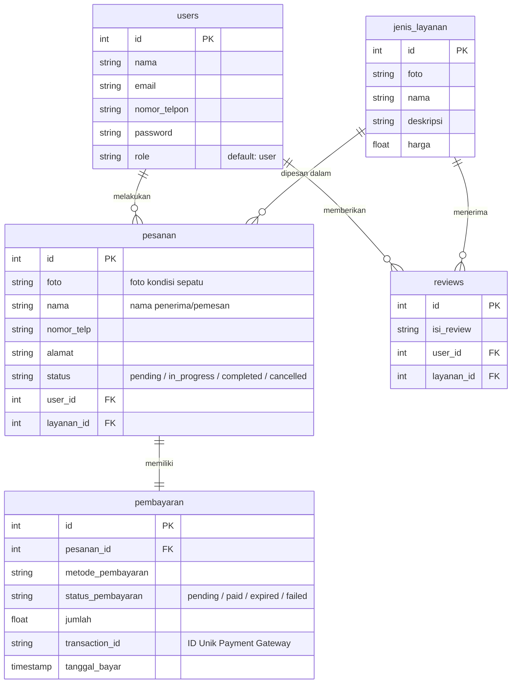

# Product Requirement Document (PRD) — Backend Service

## 1. Informasi Proyek & Ringkasan Arsitektur
* **Nama Sistem:** Eatersive Backend API Service
* **Product Manager:** Pak Mualif
* **Target Audience:** Tim Pengembang Backend & Integrator System
* **Status Document:** Draft / Technical Specification
* **Arsitektur Utama:** RESTful API Architecture (JSON payload)
* **Auth System:** Token-based Authentication (JWT / Laravel Sanctum)

---

## 2. Cakupan Logika Bisnis Backend (Core Business Logic)
Backend bertindak sebagai penyedia API untuk dua aplikasi klien: **Portal Customer** dan **Dashboard Admin/Owner**.

1. **Manajemen Pengguna & Autentikasi:** Registrasi, Login, Manajemen Session/Token, serta *Role-Based Access Control* (RBAC) memisahkan akses `Customer` dan `Owner`.
2. **Katalog & Layanan:** Menyediakan *endpoint* publik untuk membaca katalog layanan cuci sepatu serta *endpoint* terproteksi khusus Owner untuk operasi CRUD (Create, Read, Update, Delete).
3. **Manajemen Pesanan (Order Processing):** Pembuatan pesanan baru, kalkulasi total tagihan, pembaharuan status operasional cuci (*Pending* $\rightarrow$ *In Progress* $\rightarrow$ *Completed*), dan pelacakan riwayat pesanan.
4. **Sistem Pembayaran (Payment Gateway Integration):** Penanganan alur pembayaran online instan, pemuatan token transaksi, serta penerimaan *webhook / HTTP notification* otomatis dari Payment Gateway (misal: Midtrans/Xendit) untuk memperbarui status transaksi secara *real-time*.
5. **Ulasan & Rating (Review System):** Mengaitkan ulasan pengguna ke layanan yang telah dipesan setelah status pesanan selesai (*Completed*).

---

## 3. Skema Relasi Database (ERD Blueprint)

Berdasarkan perancangan data terbaru, database menggunakan 5 entitas utama:

* **`users`**: Menyimpan data kredensial, role (`user`/`admin`), dan kontak.
* **`jenis_layanan`**: Katalog menu cuci sepatu, deskripsi, foto, dan tarif harga.
* **`pesanan`**: Transaksi pemesanan cuci sepatu, alamat, jadwal, dan status operasional pengerjaan.
* **`pembayaran`**: Detail finansial pesanan, metode bayar (QRIS/VA), ID transaksi pihak ketiga, dan status bayar (`pending`, `success`, `failed`).
* **`reviews`**: Ulasan dan nilai kepuasan pelanggan atas layanan yang diterima.



┌─────────────────────────┐         ┌─────────────────────────┐
│          USER           │         │      JENIS_LAYANAN      │
├─────────────────────────┤         ├─────────────────────────┤
│ id (INT, PK)            │         │ id (INT, PK)            │
│ nama (STRING)           │         │ foto (STRING)           │
│ email (STRING)          │         │ nama (STRING)           │
│ nomor_telpon (INT)      │         │ deskripsi (STRING)      │
│ password (STRING)       │         │ harga (FLOAT)           │
│ role (STRING)           │         └────────────┬────────────┘
└───────────┬─────────────┘                      │
            │ (1 to N)                           │ (1 to N)
            ▼                                    ▼
┌─────────────────────────┐         ┌─────────────────────────┐
│         PESANAN         │         │         REVIEW          │
├─────────────────────────┤         ├─────────────────────────┤
│ id (INT, PK)            │         │ id (INT, PK)            │
│ foto (STRING)           │         │ isi_review (STRING)     │
│ nama (STRING)           │         │ user_id (INT, FK)       │
│ nomor_telp (INT)        │         │ layanan_id (INT, FK)    │
│ alamat (STRING)         │         └─────────────────────────┘
│ status (STRING)         │◄────────┐
│ user_id (INT, FK)       │         │ (1 to 1 / 1 to N)
│ layanan_id (INT, FK)    │         │
└───────────┬─────────────┘         │
            │                       │
            │ (1 to 1 / 1 to N)     │
            ▼                       │
┌───────────────────────────────────┴─────┐
│               PEMBAYARAN                │
├─────────────────────────────────────────┤
│ id (INT, PK)                            │
│ pesanan_id (INT, FK)                    │
│ metode_pembayaran (STRING)              │
│ status_pembayaran (STRING)              │
│ jumlah (FLOAT)                          │
│ transaction_id (STRING)                 │
│ tanggal_bayar (TIMESTAMP)               │
└─────────────────────────────────────────┘

---

## 4. Spesifikasi Endpoint API (API Contracts)

### A. Autentikasi (`/api/auth`)
| Method | Endpoint | Access | Deskripsi & Respons |
| :--- | :--- | :--- | :--- |
| `POST` | `/register` | Public | Mendaftarkan pengguna baru (Role: `user`). |
| `POST` | `/login` | Public | Autentikasi email & password, mengembalikan Token JWT. |
| `POST` | `/logout` | Authenticated | Menghapus token autentikasi aktif. |
| `GET` | `/me` | Authenticated | Mengambil profil pengguna yang sedang login. |

### B. Katalog Layanan (`/api/layanan`)
| Method | Endpoint | Access | Deskripsi & Respons |
| :--- | :--- | :--- | :--- |
| `GET` | `/` | Public | Mengambil daftar seluruh katalog layanan cuci sepatu. |
| `GET` | `/{id}` | Public | Detail layanan berdasarkan ID. |
| `POST` | `/` | Admin/Owner | Menambahkan menu layanan baru (Termasuk upload gambar). |
| `PUT` | `/{id}` | Admin/Owner | Memperbarui nama, deskripsi, foto, atau harga layanan. |
| `DELETE`| `/{id}` | Admin/Owner | Menghapus jenis layanan dari katalog. |

### C. Transaksi Pesanan (`/api/pesanan`)
| Method | Endpoint | Access | Deskripsi & Respons |
| :--- | :--- | :--- | :--- |
| `POST` | `/` | Customer | Membuat pesanan baru + memicu pembuatan data `pembayaran`. |
| `GET` | `/` | Admin/Owner | Menampilkan seluruh riwayat & pesanan masuk (*Dashboard Owner*). |
| `GET` | `/my-orders`| Customer | Menampilkan daftar pesanan milik pengguna yang sedang login. |
| `GET` | `/{id}` | Authenticated | Detail lengkap pesanan beserta status operasional & pembayaran. |
| `PATCH` | `/{id}/status`| Admin/Owner | Mengubah status pengerjaan sepatu (`in_progress`, `completed`). |

### D. Pembayaran & Webhook (`/api/pembayaran`)
| Method | Endpoint | Access | Deskripsi & Respons |
| :--- | :--- | :--- | :--- |
| `POST` | `/charge` | Customer | Menginisiasi *snap token* / *payment URL* dari Payment Gateway. |
| `POST` | `/webhook` | Payment Gateway | **Callback Endpoint**: Menerima verifikasi notifikasi pembayaran instan otomatis dari gateway untuk memperbarui `status_pembayaran`. |
| `GET` | `/{id}` | Authenticated | Memeriksa status transaksi pembayaran. |

### E. Ulasan & Rating (`/api/reviews`)
| Method | Endpoint | Access | Deskripsi & Respons |
| :--- | :--- | :--- | :--- |
| `GET` | `/layanan/{layanan_id}` | Public | Mengambil seluruh ulasan untuk layanan tertentu. |
| `POST` | `/` | Customer | Mengirim ulasan baru setelah pesanan selesai. |

---

## 5. Integrasi & Layanan Pihak Ketiga (Integrations)

1. **Payment Gateway (Midtrans / Xendit):**
   * Mengirimkan data payload order (`order_id`, `gross_amount`, `customer_details`).
   * Menangani keamanan *Webhook/Callback* menggunakan *Signature Key verification* untuk mencegah transaksi palsu.
2. **File & Image Storage (Cloudinary / Local Public Storage):**
   * Menangani upload gambar sepatu pelanggan (bukti kondisi awal pesanan) dan foto katalog layanan.
   * Menyimpan URL gambar yang valid ke kolom `foto` pada database.

---

## 6. Persyaratan Non-Fungsional Backend (Non-Functional Requirements)

1. **Keamanan (Security):**
   * Password di-hash menggunakan algoritma **Bcrypt / Argon2**.
   * Proteksi *Middleware* berbasis token untuk memastikan role `user` tidak dapat mengakses API khusus `admin/owner`.
   * Implementasi *CORS (Cross-Origin Resource Sharing)* dan *Rate Limiting* untuk mencegah serangan Brute-force/DDoS.
2. **Validasi Data (Input Validation):**
   * Seluruh request body wajib mematuhi skema validasi (misal: format email valid, nomor telepon angka, harga bernilai positif).
3. **Penanganan Error (Error Handling Standard):**
   * Format respons standar menggunakan format JSON konsisten:
     ```json
     {
       "success": false,
       "message": "Detail pesan kesalahan",
       "errors": null
     }
     ```
   * Menggunakan HTTP status code yang representatif (`200 OK`, `201 Created`, `400 Bad Request`, `401 Unauthorized`, `403 Forbidden`, `404 Not Found`, `500 Internal Server Error`).