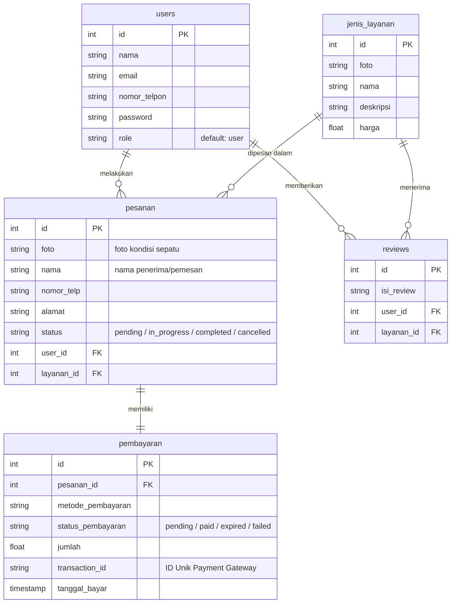

# Product Requirement Document (PRD) — Backend Service

## 1. Informasi Proyek & Ringkasan Arsitektur
* **Nama Sistem:** Eatersive Backend API Service
* **Product Manager:** Pak Mualif
* **Target Audience:** Tim Pengembang Backend & Integrator System
* **Status Document:** Draft / Technical Specification
* **Arsitektur Utama:** RESTful API Architecture (JSON payload)
* **Auth System:** Token-based Authentication (JWT / Laravel Sanctum)

---

## 2. Cakupan Logika Bisnis Backend (Core Business Logic)
Backend bertindak sebagai penyedia API untuk dua aplikasi klien: **Portal Customer** dan **Dashboard Admin/Owner**.

1. **Manajemen Pengguna & Autentikasi:** Registrasi, Login, Manajemen Session/Token, serta *Role-Based Access Control* (RBAC) memisahkan akses `Customer` dan `Owner`.
2. **Katalog & Layanan:** Menyediakan *endpoint* publik untuk membaca katalog layanan cuci sepatu serta *endpoint* terproteksi khusus Owner untuk operasi CRUD (Create, Read, Update, Delete).
3. **Manajemen Pesanan (Order Processing):** Pembuatan pesanan baru, kalkulasi total tagihan, pembaharuan status operasional cuci (*Pending* $\rightarrow$ *In Progress* $\rightarrow$ *Completed*), dan pelacakan riwayat pesanan.
4. **Sistem Pembayaran (Payment Gateway Integration):** Penanganan alur pembayaran online instan, pemuatan token transaksi, serta penerimaan *webhook / HTTP notification* otomatis dari Payment Gateway (misal: Midtrans/Xendit) untuk memperbarui status transaksi secara *real-time*.
5. **Ulasan & Rating (Review System):** Mengaitkan ulasan pengguna ke layanan yang telah dipesan setelah status pesanan selesai (*Completed*).

---

## 3. Skema Relasi Database (ERD Blueprint)

Berdasarkan perancangan data terbaru, database menggunakan 5 entitas utama:

* **`users`**: Menyimpan data kredensial, role (`user`/`admin`), dan kontak.
* **`jenis_layanan`**: Katalog menu cuci sepatu, deskripsi, foto, dan tarif harga.
* **`pesanan`**: Transaksi pemesanan cuci sepatu, alamat, jadwal, dan status operasional pengerjaan.
* **`pembayaran`**: Detail finansial pesanan, metode bayar (QRIS/VA), ID transaksi pihak ketiga, dan status bayar (`pending`, `success`, `failed`).
* **`reviews`**: Ulasan dan nilai kepuasan pelanggan atas layanan yang diterima.



┌─────────────────────────┐         ┌─────────────────────────┐
│          USER           │         │      JENIS_LAYANAN      │
├─────────────────────────┤         ├─────────────────────────┤
│ id (INT, PK)            │         │ id (INT, PK)            │
│ nama (STRING)           │         │ foto (STRING)           │
│ email (STRING)          │         │ nama (STRING)           │
│ nomor_telpon (INT)      │         │ deskripsi (STRING)      │
│ password (STRING)       │         │ harga (FLOAT)           │
│ role (STRING)           │         └────────────┬────────────┘
└───────────┬─────────────┘                      │
            │ (1 to N)                           │ (1 to N)
            ▼                                    ▼
┌─────────────────────────┐         ┌─────────────────────────┐
│         PESANAN         │         │         REVIEW          │
├─────────────────────────┤         ├─────────────────────────┤
│ id (INT, PK)            │         │ id (INT, PK)            │
│ foto (STRING)           │         │ isi_review (STRING)     │
│ nama (STRING)           │         │ user_id (INT, FK)       │
│ nomor_telp (INT)        │         │ layanan_id (INT, FK)    │
│ alamat (STRING)         │         └─────────────────────────┘
│ status (STRING)         │◄────────┐
│ user_id (INT, FK)       │         │ (1 to 1 / 1 to N)
│ layanan_id (INT, FK)    │         │
└───────────┬─────────────┘         │
            │                       │
            │ (1 to 1 / 1 to N)     │
            ▼                       │
┌───────────────────────────────────┴─────┐
│               PEMBAYARAN                │
├─────────────────────────────────────────┤
│ id (INT, PK)                            │
│ pesanan_id (INT, FK)                    │
│ metode_pembayaran (STRING)              │
│ status_pembayaran (STRING)              │
│ jumlah (FLOAT)                          │
│ transaction_id (STRING)                 │
│ tanggal_bayar (TIMESTAMP)               │
└─────────────────────────────────────────┘

---

## 4. Spesifikasi Endpoint API (API Contracts)

### A. Autentikasi (`/api/auth`)
| Method | Endpoint | Access | Deskripsi & Respons |
| :--- | :--- | :--- | :--- |
| `POST` | `/register` | Public | Mendaftarkan pengguna baru (Role: `user`). |
| `POST` | `/login` | Public | Autentikasi email & password, mengembalikan Token JWT. |
| `POST` | `/logout` | Authenticated | Menghapus token autentikasi aktif. |
| `GET` | `/me` | Authenticated | Mengambil profil pengguna yang sedang login. |

### B. Katalog Layanan (`/api/layanan`)
| Method | Endpoint | Access | Deskripsi & Respons |
| :--- | :--- | :--- | :--- |
| `GET` | `/` | Public | Mengambil daftar seluruh katalog layanan cuci sepatu. |
| `GET` | `/{id}` | Public | Detail layanan berdasarkan ID. |
| `POST` | `/` | Admin/Owner | Menambahkan menu layanan baru (Termasuk upload gambar). |
| `PUT` | `/{id}` | Admin/Owner | Memperbarui nama, deskripsi, foto, atau harga layanan. |
| `DELETE`| `/{id}` | Admin/Owner | Menghapus jenis layanan dari katalog. |

### C. Transaksi Pesanan (`/api/pesanan`)
| Method | Endpoint | Access | Deskripsi & Respons |
| :--- | :--- | :--- | :--- |
| `POST` | `/` | Customer | Membuat pesanan baru + memicu pembuatan data `pembayaran`. |
| `GET` | `/` | Admin/Owner | Menampilkan seluruh riwayat & pesanan masuk (*Dashboard Owner*). |
| `GET` | `/my-orders`| Customer | Menampilkan daftar pesanan milik pengguna yang sedang login. |
| `GET` | `/{id}` | Authenticated | Detail lengkap pesanan beserta status operasional & pembayaran. |
| `PATCH` | `/{id}/status`| Admin/Owner | Mengubah status pengerjaan sepatu (`in_progress`, `completed`). |

### D. Pembayaran & Webhook (`/api/pembayaran`)
| Method | Endpoint | Access | Deskripsi & Respons |
| :--- | :--- | :--- | :--- |
| `POST` | `/charge` | Customer | Menginisiasi *snap token* / *payment URL* dari Payment Gateway. |
| `POST` | `/webhook` | Payment Gateway | **Callback Endpoint**: Menerima verifikasi notifikasi pembayaran instan otomatis dari gateway untuk memperbarui `status_pembayaran`. |
| `GET` | `/{id}` | Authenticated | Memeriksa status transaksi pembayaran. |

### E. Ulasan & Rating (`/api/reviews`)
| Method | Endpoint | Access | Deskripsi & Respons |
| :--- | :--- | :--- | :--- |
| `GET` | `/layanan/{layanan_id}` | Public | Mengambil seluruh ulasan untuk layanan tertentu. |
| `POST` | `/` | Customer | Mengirim ulasan baru setelah pesanan selesai. |

---

## 5. Integrasi & Layanan Pihak Ketiga (Integrations)

1. **Payment Gateway (Midtrans / Xendit):**
   * Mengirimkan data payload order (`order_id`, `gross_amount`, `customer_details`).
   * Menangani keamanan *Webhook/Callback* menggunakan *Signature Key verification* untuk mencegah transaksi palsu.
2. **File & Image Storage (Cloudinary / Local Public Storage):**
   * Menangani upload gambar sepatu pelanggan (bukti kondisi awal pesanan) dan foto katalog layanan.
   * Menyimpan URL gambar yang valid ke kolom `foto` pada database.

---

## 6. Persyaratan Non-Fungsional Backend (Non-Functional Requirements)

1. **Keamanan (Security):**
   * Password di-hash menggunakan algoritma **Bcrypt / Argon2**.
   * Proteksi *Middleware* berbasis token untuk memastikan role `user` tidak dapat mengakses API khusus `admin/owner`.
   * Implementasi *CORS (Cross-Origin Resource Sharing)* dan *Rate Limiting* untuk mencegah serangan Brute-force/DDoS.
2. **Validasi Data (Input Validation):**
   * Seluruh request body wajib mematuhi skema validasi (misal: format email valid, nomor telepon angka, harga bernilai positif).
3. **Penanganan Error (Error Handling Standard):**
   * Format respons standar menggunakan format JSON konsisten:
     ```json
     {
       "success": false,
       "message": "Detail pesan kesalahan",
       "errors": null
     }
     ```
   * Menggunakan HTTP status code yang representatif (`200 OK`, `201 Created`, `400 Bad Request`, `401 Unauthorized`, `403 Forbidden`, `404 Not Found`, `500 Internal Server Error`).
---

## Log Implementasi � Tahap 4: Pesanan + Payment Midtrans (Opsi A)

### 8. Rekap Perubahan Code & File

 Tahap 4 dikerjakan sesuai kontrak frontend `src/api/orders.ts` (Opsi A).
 Status: **Selesai** � 42/42 test lulus (`php artisan test`), frontend
 typecheck/lint/build lulus.

#### 8.1 Dependensi Baru (composer)

| Paket | Versi | Fungsi |
| --- | --- | --- |
| `midtrans/midtrans-php` | ^2.6 | Klien Snap/Charge, Status API |
| `laravel/boost` (dev) | ^2.10 | Tooling developer (AGENTS.md guidelines) |

#### 8.2 Migrasi Baru

| File | Isi |
| --- | --- |
| `2026_11_07_000001_add_order_fields_to_pesanan_table.php` | Kolom baru `pesanan`: `kode_pesanan` (unique nullable), `kode_grup` (index nullable), `catatan` (text), `jumlah` (int, default 1), `total_harga` (decimal 12,2), `estimasi_selesai` (date) |
| `2026_11_07_000002_create_pesanan_status_logs_table.php` | Tabel `pesanan_status_logs` (timeline status: status, status_label, catatan, changed_by) |
| `2026_11_07_000003_add_nomor_telp_to_users_table.php` | Kolom `nomor_telp` (nullable) di `users` untuk profil owner |

#### 8.3 Kode Backend Baru / Diubah

| File | Perubahan |
| --- | --- |
| `app/Enums/OrderStatus.php` (baru) | Enum status pesanan kontrak frontend + label `Menunggu/Dikonfirmasi/Sedang Dikerjakan/Pengecekan/Selesai/Dibatalkan`, konstanta `INITIAL` dan `ADMIN_SETTABLE` |
| `app/Enums/PaymentStatus.php` (baru) | Enum status pembayaran PRD: pending/paid/expired/failed/refunded |
| `app/Models/Pesanan.php` (diubah) | Fillable baru, cast (`status` enum, `total_harga` decimal, `jumlah` int, `estimasi_selesai` date), appends `status_label`, relasi `timeline()` |
| `app/Models/PesananStatusLog.php` (baru) | Model log timeline + `record()` (label disimpan saat baris dibuat) |
| `app/Models/Pembayaran.php` (diubah) | Cast `jumlah` decimal & `tanggal_bayar` datetime |
| `app/Models/User.php` (diubah) | Fillable + `nomor_telp` |
| `app/Services/MidtransService.php` (baru) | Boot kredensial dari `config/midtrans.php`, `createSnapTransaction`, `getTransactionStatus`, `verifySignature` (sha512 order+status+gross+serverkey), `mapTransactionStatus`, `applyStatus` (idempotent + sinkronisasi pesanan/log) |
| `app/Http/Controllers/PesananController.php` (diisi) | `index` (pesanan milik user), `store` (hitung ulang total dari DB, buat pembayaran pending + log, kode ORD-/GRUP- unik), `show` (403 antar user), `updateStatus` (admin; timeline + catatan), `ownerOrders` |
| `app/Http/Controllers/PembayaranController.php` (diisi) | `charge` (Snap per kode_grup; guard configured/ownership; simpan transaction_id), `status` (polling jalur utama local via Get Status API), `webhook` (tanpa auth; verifikasi signature; selalu 200 setelah validasi) |
| `app/Http/Controllers/OwnerController.php` (baru) | `dashboard` (hitungan per status, total omset paid, recent 10), `profile`/`updateProfile`, `updatePassword` |
| `routes/api.php` (diubah) | Group `orders` (GET/POST/GET {id}, PATCH {id}/status admin), `pembayaran` (charge, {pesananId}/status, webhook), `owner` (dashboard, orders, profile, password) |
| `config/midtrans.php` (baru) | Membaca `MIDTRANS_SERVER_KEY`, `MIDTRANS_CLIENT_KEY`, `MIDTRANS_IS_PRODUCTION`, `MIDTRANS_IS_3DS` |
| `.env` & `.env.example` (diubah) | Bagian baru: kunci Midtrans (server/client/is_production) |

#### 8.4 Pemetaan Status (Webhook/Status API Midtrans)

| transaction_status | status_pembayaran | pesanan.status |
| --- | --- | --- |
| `capture` (fraud=accept) / `settlement` | `paid` | `confirmed` (+log) |
| `capture` (fraud=challenge) | `pending` | `pending` |
| `pending` | `pending` | `pending` |
| `deny` / `cancel` | `failed` | `cancelled`(+log, hanya bila belum dikerjakan) |
| `expire` | `expired` | tetap (bisa charge ulang) |
| `refund` / `partial_refund` | `refunded` | � |

#### 8.5 Kontrak Endpoint Baru

| Method | URI | Auth | Keterangan |
| --- | --- | --- | --- |
| GET/POST | `/api/v1/orders` | sanctum | Daftar milik user / buat pesanan |
| GET | `/api/v1/orders/{id}` | sanctum | Detail + relasi (403 antar user) |
| PATCH | `/api/v1/orders/{id}/status` | sanctum+admin | Status flow + timeline |
| POST | `/api/v1/pembayaran/charge` | sanctum | `snap_token` + `client_key` + `redirect_url` |
| GET | `/api/v1/pembayaran/{pesananId}/status` | sanctum | Polling status (menghubungi Midtrans bila pending) |
| POST | `/api/v1/pembayaran/webhook` | publik | Midtrans notification (signature required) |
| GET | `/api/v1/owner/dashboard`, `GET /api/v1/owner/orders`, `GET/PUT /api/v1/owner/profile`, `PUT /api/v1/owner/password` | sanctum+admin | Dashboard & akun owner |

#### 8.6 Frontend (Ditulis oleh pihak frontend, dicatat untuk referensi)

| File | Perubahan |
| --- | --- |
| `src/lib/payments.ts` (baru) | `chargeOrderPayment`, `refreshOrderPaymentStatus`, `loadSnapScript` (client_key dari charge), `payWithSnap` (window.snap.pay) |
| `src/pages/user/KonfirmasiPesananPage.tsx` (diubah) | Muat detail order → tombol **Bayar Sekarang** (status pending) → popup Snap → polling status tiap 6 detik sampai lunas/berakhir, label status pembayaran |
| Comment | Front end `api/orders.ts` sudah dipetakan ke endpoint ini (Order, CreateOrderInput, updateOrderStatus, dst.) |

#### 8.7 Pengujian Baru (PHPUnit)

| File | Cakupan |
| --- | --- |
| `tests/Feature/Api/PesananTest.php` | Guest 401, store 201 + hitung total sepenuhnya dari DB, validasi required, 403 antar-customer, update_status admin + timeline, status tidak valid 422, customer tidak bisa update status, owner list (admin 200 / user 403) |
| `tests/Feature/Api/PembayaranWebhookTest.php` | signature salah 401, settlement → paid+confirmed+log, webhook dobel idempotensi, expire → expired (pesanan tetap pending), cancel → failed+cancelled, order_id tidak dikenal diabaikan |
| `tests/Feature/Api/OwnerTest.php` | dashboard (hitungan + omset), profil nomor_telp, password salah 422 / benar 200, customer tidak akses endpoint owner |

> Catatan teknis: dalam test multi-request, identitas auth tersimpan pada guard
> (`RequestGuard` meng-cache `$user`). Gunakan `Auth::forgetGuards()` sebelum
> mengganti user pada request berikutnya dalam satu test method.

#### 8.8 Environment (API key placement)

```
backend/.env
MIDTRANS_SERVER_KEY=SB-Mid-server-xxxxx   # kunci rahasia
MIDTRANS_CLIENT_KEY=SB-Mid-client-xxxxx   # dikirim ke frontend via charge
MIDTRANS_IS_PRODUCTION=false              # sandbox
```

#### 8.9 Hotfix Charge-Ulang (GRUP-... "already been taken")

Skenario: popup dibuka lalu ditutup (X) sebelum pembayarannya diperkarakan,
kemudian tombol Bayar Sekarang dipencet lagi. Transaksi lama masih terbuka di
Midtrans sehingga charge dengan order_id yang sama ditolak, dan frontend
menerima HTTP 502.

Perubahan pada `app/Http/Controllers/PembayaranController.php`:

| Aspek | Sebelum | Sesudah |
| --- | --- | --- |
| order_id tetap | Gagal 502 bila order_id sudah terpakai | Varian sufis urut: `kode_grup`, `-2`, `-3` (maks `MAX_ORDER_ID_RETRIES = 3` percobaan) |
| Respons error | 502 generik untuk semua kegagalan createSnap | 409 dengan pesan Indonesia bila `already been taken` (retry habis); 502 untuk kegagalan lain |
| transaction_id | Tetap kode_grup | Ditimpa oleh order_id varian yang dipakai, agar polling & webhook mengikuti transaksi terbaru |

Terbukti secara manual terhadap sandbox nyata: charge `GRUP-V5W6VEXD` menolak
(400 already taken), charge `GRUP-V5W6VEXD-2` sukses (201, token diterima).
42/42 test tetap lulus; skenario ini dicatat sebagai jalur integrasi eksternal
(yang diverifikasi manual karena lib midtrans-php memanggil API nyata).
